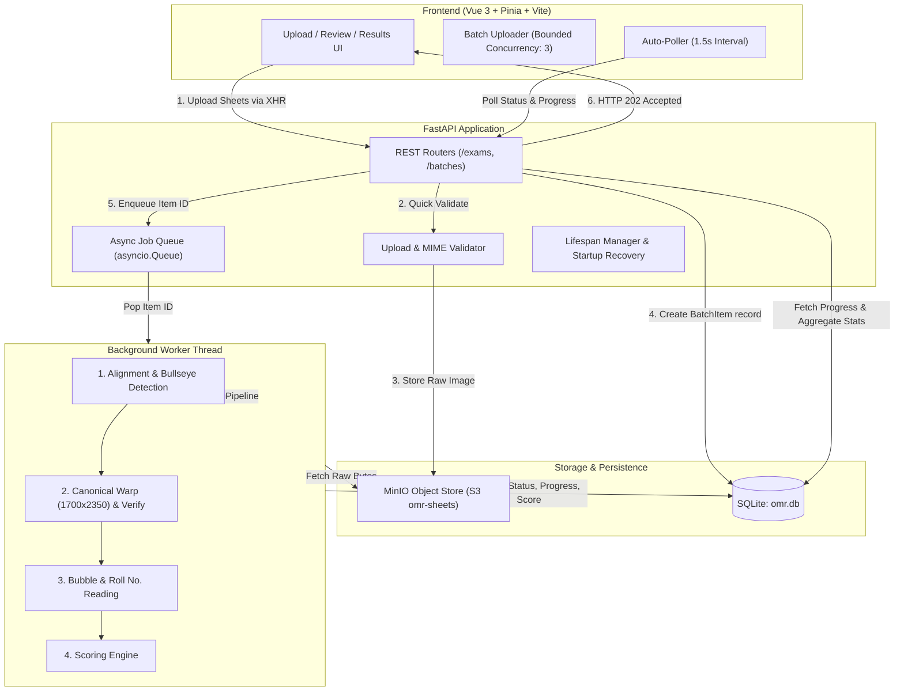

# Ambition Guru OMR Evaluation System (OMR Track)

An enterprise-grade, high-precision Optical Mark Recognition (OMR) processing and evaluation engine designed for high-stakes academic and competitive examinations. The system automates sheet alignment, 5-digit roll number recognition, 200-question multiple-choice bubble reading, dynamic scoring, and human-in-the-loop review.

---

## 📑 Table of Contents

- [System Overview](#-system-overview)
- [Key Features](#-key-features)
- [System Architecture](#-system-architecture)
- [Computer Vision & Image Processing Pipeline](#-computer-vision--image-processing-pipeline)
  - [1. Bullseye Registration Marker Detection](#1-bullseye-registration-marker-detection)
  - [2. Perspective Transformation (Canonical Warping)](#2-perspective-transformation-canonical-warping)
  - [3. Post-Warp Verification](#3-post-warp-verification)
  - [4. Bubble Reading & Classification](#4-bubble-reading--classification)
  - [5. Roll Number Recognition](#5-roll-number-recognition)
- [Batch Processing & Lifecycle State Machine](#-batch-processing--lifecycle-state-machine)
- [Tech Stack](#-tech-stack)
- [Project Directory Structure](#-project-directory-structure)
- [Getting Started](#-getting-started)
  - [Prerequisites](#prerequisites)
  - [1. Object Storage (MinIO)](#1-object-storage-minio)
  - [2. Backend Setup](#2-backend-setup)
  - [3. Frontend Setup](#3-frontend-setup)
- [Template Calibration (`generate_template.py`)](#-template-calibration-generate_templatepy)
- [API Endpoints Summary](#-api-endpoints-summary)
- [Scoring Engine & Policy Configuration](#-scoring-engine--policy-configuration)
- [Testing](#-testing)
- [Documentation Index](#-documentation-index)

---

## 🌟 System Overview

The **Ambition Guru OMR Evaluation System** provides end-to-end automated grading for physical test answer sheets. Built to handle standard 200-question sheets (4 options: A, B, C, D) alongside 5-digit student registration numbers, it replaces error-prone manual grading with a fault-tolerant, asynchronous computer vision pipeline.

### Core Objectives
1. **Geometric Invariance**: Accurately align skewed, rotated, perspective-distorted, or slightly crumpled sheet scans.
2. **Deterministic Bubble Classification**: Distinguish true student intent from faint eraser smudges, multiple marks, and stray pencil marks using dual-threshold fill-ratio analysis.
3. **Human-in-the-Loop Safeguards**: Flag ambiguous marks or uncertain roll numbers into a specialized review dashboard before final grades are locked.
4. **Non-Blocking Asynchronous Processing**: Instantly accept file uploads via HTTP `202 Accepted` and offload heavy image processing to background worker threads.
5. **Secure Object Storage**: Store all raw sheet images in MinIO S3-compatible storage with cryptographically safe UUID keys.

---

## ✨ Key Features

- **Concentric Marker Detection**: Detects 4-corner bullseye registration marks using nested circular contour clustering, impervious to text and stray marks.
- **Canonical Warping (1700 × 2350 px)**: Normalizes images into fixed pixel coordinates regardless of scan resolution or camera angle.
- **Verification Gatekeeper**: Re-verifies marker positions on the warped sheet; fails fast if alignment drifts by more than 25 pixels.
- **Calibrated Roll Number Detection**: Identifies 5-column numeric grids (0–9) using Hough Circle transforms and self-consistency gap validation.
- **Configurable Scoring Engine**: Supports correct points, incorrect penalty (negative marking), blank deductions, and custom rounding (e.g., quarter-point `0.25` or half-point `0.5`).
- **Interactive Review UI**: Vue 3 modal flagging questionable questions, allowing proctors to inspect and correct answers or roll numbers in seconds.
- **Formula-Injection-Safe CSV Export**: Automatically neutralizes CSV injection vulnerabilities (`=`, `+`, `-`, `@`) when exporting batch results.
- **Crash-Resilient Task Queue**: Restores orphaned jobs on backend restart via `requeue_stale_items()`.

---

## 🏗️ System Architecture



---

## 🔬 Computer Vision & Image Processing Pipeline

The image processing engine in `app/services/alignment.py` and `app/services/bubble_reading.py` executes in four rigorous stages:

### 1. Bullseye Registration Marker Detection
Each sheet has 4 bullseye markers (nested concentric circles) at its corners.
- Converts the image to grayscale and inverts threshold (`cv2.THRESH_BINARY_INV`).
- Extracts contours using `cv2.findContours(..., cv2.RETR_TREE)`.
- Calculates contour circularity:
  $$\text{Fill Ratio} = \frac{\text{Contour Area}}{\pi \cdot r^2} > 0.85$$
- Clusters nearby concentric circle centers within a 15-pixel Euclidean distance threshold.
- A valid marker requires **at least 3 concentric rings**. Noise, bubbles, and text produce at most 1–2 rings and are discarded.
- Resolves the 4 clusters into `top_left`, `top_right`, `bottom_left`, and `bottom_right` by comparing coordinates against image centroids.

### 2. Perspective Transformation (Canonical Warping)
- Maps the 4 detected corners to predefined template markers in a canonical **1700 × 2350 px** plane with a 60 px margin:
  $$M = \text{cv2.getPerspectiveTransform}(\text{src\_pts}, \text{dst\_pts})$$
  $$\text{Warped} = \text{cv2.warpPerspective}(\text{img}, M, (1700, 2350))$$

### 3. Post-Warp Verification
- Runs `find_registration_markers()` directly on the **warped** grayscale image.
- Compares re-detected marker coordinates with expected template coordinates.
- If any corner marker deviates by more than `tolerance_px = 25`, the sheet fails immediately with error code `alignment_failed`.

### 4. Bubble Reading & Classification
- Template defines normalized $(x, y, r)$ coordinates for all 200 questions × 4 choices (800 bubbles).
- For each bubble, a circular region of interest (ROI) mask is applied:
  $$\text{Fill Ratio} = \frac{\sum [I(x, y) < 150]}{\text{Total ROI Pixels}}$$
- **Decision Boundaries**:
  - **Blank**: $\text{top1\_fill} < 0.25$
  - **Multiple Marks**: $\ge 2\text{ options with fill} \ge 0.40$
  - **Ambiguous**: $(\text{top1\_fill} - \text{top2\_fill}) < 0.15$ (routes sheet to `needs_review`)
  - **Single Clean Mark**: Assigned the top option.

### 5. Roll Number Recognition
- Evaluates the 5-digit roll number matrix (5 columns × 10 digits `0`–`9`).
- Employs the same `classify_question()` logic on each column.
- If any column produces a blank, multiple, or ambiguous reading, the digit is labeled as `?` and the sheet is flagged with `needs_review = true`.

---

## 🔄 Batch Processing & Lifecycle State Machine

Each uploaded answer sheet progresses through distinct lifecycle statuses:

```
[Uploading] ──(XHR POST)──> [Queued] ──(Worker Pickup)──> [Processing]
                                                               │
                                ┌──────────────────────────────┼──────────────────────────────┐
                                ▼                              ▼                              ▼
                           [Completed]                  [Needs Review]                     [Failed]
                        (Clean alignment             (Ambiguous marks or              (Corrupt file,
                         & clean bubbles)             uncertain roll no.)              bad markers)
                                │                              │                              │
                                │                              ▼                              ▼
                                │                     Operator Manual Edit           Re-upload via Retry
                                │                   (/items/{id}/review)           (/items/{id}/retry)
                                │                              │                              │
                                └──────────────────────────────┼──────────────────────────────┘
                                                               ▼
                                                      Batch Results CSV
```

### Processing Stages and Progress Reporting
During the `processing` state, granular progress updates are published:
- `validating` (10%): File headers, MIME type, and dimension constraints (200px–6000px).
- `aligning` (35%): Corner bullseye detection, perspective warping, and verification.
- `thresholding` (50%): Image binarization and circular ROI masking.
- `reading_bubbles` (85%): Main grid reading and roll number extraction.
- `scoring` (90%): Answer key evaluation against scoring rules.
- `saving` (95%): Database commit and batch counter synchronization.

---

## 💻 Tech Stack

| Domain | Technology | Description |
|---|---|---|
| **Backend Framework** | [FastAPI](https://fastapi.tiangolo.com/) (Python 3.10+) | High-performance asynchronous REST API |
| **Computer Vision** | [OpenCV (`cv2`)](https://opencv.org/), [NumPy](https://numpy.org/), [scikit-learn](https://scikit-learn.org/) | Marker detection, warping, Hough circles, clustering |
| **Database & ORM** | [SQLAlchemy 2.0](https://www.sqlalchemy.org/) / SQLite | Relational schema management with JSON fields |
| **Object Storage** | [MinIO](https://min.io/) (S3-compatible API) | Secure storage for raw scanned sheets |
| **Worker / Queue** | Python `asyncio.Queue` + `asyncio.to_thread` | Concurrency isolation for CPU-intensive image tasks |
| **Frontend Framework** | [Vue 3](https://vuejs.org/) (Composition API, `<script setup lang="ts">`) | Modern, reactive web interface |
| **State Management** | [Pinia 4](https://pinia.vuejs.org/) | Reactive store with upload queue & live polling |
| **Tooling & Build** | [Vite 8](https://vitejs.dev/), TypeScript, Oxlint, ESLint | Instant HMR and type-safe frontend build |
| **Containerization** | Docker & Docker Compose | Containerized MinIO local infrastructure |

---

## 📁 Project Directory Structure

```
/home/murari/tracks/omr/
├── docker-compose.yml              # MinIO S3 object storage container definition
├── README.md                       # Main project documentation
├── docs/                           # Architectural & API reference documents
│   ├── ARCHITECTURE.md             # Detailed engineering & mathematical spec
│   └── API_REFERENCE.md            # REST API schema and endpoint documentation
├── backend/
│   ├── config.env                  # Environment variables (DB, MinIO credentials)
│   ├── requirements.txt            # Python dependencies
│   ├── omr.db                      # SQLite production/test database
│   ├── test_day4.py                # Async polling integration script
│   ├── test_day4_batch.py          # Batch upload integration test
│   ├── test_full_pipeline.py       # End-to-end API pipeline exercise script
│   ├── test_retry.py               # Failed item retry integration test
│   ├── app/
│   │   ├── main.py                 # FastAPI application & lifespan management
│   │   ├── core/
│   │   │   └── config.py           # Pydantic Settings configuration
│   │   ├── db/
│   │   │   ├── base.py             # SQLAlchemy Declarative Base
│   │   │   └── session.py          # Database session maker & dependency
│   │   ├── models/
│   │   │   ├── exam.py             # Exam model (Answer key & scoring policy)
│   │   │   └── batch.py            # Batch model (status & aggregate counters)
│   │   │   └── batch_item.py       # BatchItem model (stages, raw/confirmed answers)
│   │   ├── schemas/
│   │   │   ├── exam.py             # Pydantic input/output schemas for exams
│   │   │   └── batch.py            # Pydantic schemas for batches, items, reviews
│   │   ├── api/v1/
│   │   │   ├── exams.py            # /exams endpoints
│   │   │   └── batches.py          # /batches, /items, /retry, /review, /results.csv
│   │   ├── services/
│   │   │   ├── alignment.py        # Bullseye marker detection & canonical warp
│   │   │   ├── bubble_reading.py   # Fill ratio calculations & classification
│   │   │   ├── scoring.py          # Dynamic grading & rounding logic
│   │   │   ├── storage.py          # MinIO S3 client upload/download utilities
│   │   │   ├── uploads.py          # File size, MIME, & dimension validation
│   │   │   ├── jobs.py             # Queue worker loop & startup crash recovery
│   │   │   └── exports.py          # Formula-sanitized CSV builder
│   │   └── templates/
│   │       ├── generate_template.py           # Hough-circle geometric calibration script
│   │       └── template_ambition_guru_v1.json # Master coordinate template (850 bubbles)
│   └── tests/
│       ├── test_scoring.py         # Unit tests for scoring engine & edge cases
│       ├── test_exports.py         # Unit tests for CSV generation & sanitization
│       └── test_bubble_reading.py  # Unit tests for roll number extraction
└── frontend/
    ├── index.html
    ├── package.json                # NPM scripts and dependencies
    ├── vite.config.ts              # Vite configuration
    └── src/
        ├── App.vue                 # App shell with header & navigation
        ├── main.ts                 # Vue entry point with Pinia & Router
        ├── router/index.ts         # Routes: '/' (Upload) and '/batches/:id/results'
        ├── api/
        │   ├── client.ts           # Fetch API wrapper
        │   └── omr.ts              # Typed API calls & XHR upload with progress
        ├── stores/
        │   └── omr.ts              # Pinia store managing batches, uploads, & polling
        ├── types/
        │   └── omr.ts              # TypeScript interfaces for API & UI state
        ├── views/
        │   ├── UploadView.vue      # Exam creation, batch upload, & modal review
        │   └── ResultsView.vue     # Batch results table & CSV download
        └── components/
            ├── BatchUploader.vue   # Drag-and-drop zone with bounded concurrency
            ├── ItemProgress.vue    # Progress bar with dynamic stage/status badges
            ├── SheetReview.vue     # 200-question review modal + roll number editor
            └── AnswerKeyEditor.vue # Interactive answer key configuration matrix
```

---

## 🚀 Getting Started

### Prerequisites
- **Operating System**: Linux / macOS
- **Python**: 3.10 or higher
- **Node.js**: v22.x or higher
- **Docker**: Docker Engine & Docker Compose

---

### 1. Object Storage (MinIO)
Start the MinIO container from the project root:

```bash
cd /home/murari/tracks/omr
docker compose up -d
```

MinIO will be available at:
- **S3 API**: `http://127.0.0.1:9010`
- **Web Console**: `http://127.0.0.1:9011` (User: `minioadmin` / Pass: `minioadmin123`)

---

### 2. Backend Setup

1. Navigate to the backend directory:
   ```bash
   cd /home/murari/tracks/omr/backend
   ```
2. Activate your virtual environment (or create one):
   ```bash
   source .env/bin/activate
   pip install -r requirements.txt
   ```
3. Verify or edit `config.env`:
   ```ini
   DATABASE_URL=sqlite:///./omr.db
   MINIO_ENDPOINT=127.0.0.1:9010
   MINIO_ACCESS_KEY=minioadmin
   MINIO_SECRET_KEY=minioadmin123
   MINIO_SECURE=false
   MINIO_BUCKET=omr-sheets
   ```
4. Start the FastAPI server with live reloading:
   ```bash
   uvicorn app.main:app --host 0.0.0.0 --port 8000 --reload
   ```
5. Check health:
   ```bash
   curl http://127.0.0.1:8000/health
   # Expected output: {"status":"ok"}
   ```

---

### 3. Frontend Setup

1. Open a new terminal and navigate to the frontend directory:
   ```bash
   cd /home/murari/tracks/omr/frontend
   ```
2. Install dependencies:
   ```bash
   npm install
   ```
3. Start the Vite development server:
   ```bash
   npm run dev
   ```
4. Open your browser and navigate to `http://localhost:5173`.

---

## 📐 Template Calibration (`generate_template.py`)

Coordinate accuracy is critical to prevent cumulative drift across 200 questions. Never hand-code pixel coordinates. The calibration utility measures real sheet geometry:

```bash
cd /home/murari/tracks/omr/backend
python app/templates/generate_template.py /path/to/sample_sheet.jpg
```

### How Calibration Works:
1. Detects registration markers on the clean sample and warps to canonical `(1700 × 2350)`.
2. Applies `cv2.HoughCircles` across the question column areas.
3. Groups vertical center positions using median gap analysis (`resolve_rows()`) to guarantee exactly 50 rows per column.
4. Detects the 5-digit roll number matrix using KMeans clustering ($K=5$) and evaluates gap consistency (`is_self_consistent()`).
5. Generates `template_ambition_guru_v1.json` containing 800 main bubbles + 50 roll number bubbles with relative $(x, y, r)$ coordinates.

---

## 📡 API Endpoints Summary

| Method | Path | Description | Response Code |
|---|---|---|---|
| `GET` | `/health` | Service health status check | `200 OK` |
| `POST` | `/api/v1/exams` | Create an exam with answer key & scoring policy | `200 OK` |
| `GET` | `/api/v1/exams` | List all configured exams | `200 OK` |
| `GET` | `/api/v1/exams/{id}` | Retrieve specific exam details | `200 OK` |
| `DELETE`| `/api/v1/exams/{id}` | Delete an exam | `204 No Content` |
| `POST` | `/api/v1/exams/{id}/batches` | Create a new processing batch for an exam | `200 OK` |
| `GET` | `/api/v1/batches/{id}` | Get batch summary & aggregate counts | `200 OK` |
| `GET` | `/api/v1/batches/{id}/items` | List all items in a batch | `200 OK` |
| `POST` | `/api/v1/batches/{id}/items` | Upload sheet image (Async queued) | `202 Accepted` |
| `POST` | `/api/v1/batches/{id}/items/{item_id}/retry` | Re-upload image for a failed sheet | `202 Accepted` |
| `POST` | `/api/v1/batches/{id}/items/{item_id}/review` | Submit proctor review & recalculate score | `200 OK` |
| `POST` | `/api/v1/batches/{id}/items/manual` | Directly submit answers without an image | `200 OK` |
| `GET` | `/api/v1/batches/{id}/results.csv` | Export batch results as sanitized CSV | `200 OK` |

*Detailed request/response payloads, headers, and schemas are documented in [docs/API_REFERENCE.md](docs/API_REFERENCE.md).*

---

## 🎯 Scoring Engine & Policy Configuration

The scoring engine (`app/services/scoring.py`) calculates marks strictly adhering to the exam's `ScoringPolicy`:

```json
{
  "points_correct": 1.0,
  "points_incorrect": 0.0,
  "points_blank": 0.0,
  "points_multiple": 0.0,
  "negative_marking": 0.25,
  "rounding": "0.25"
}
```

### Evaluation Logic
- **Correct**: $\text{score} += \text{points\_correct}$
- **Incorrect**: $\text{score} += \text{points\_incorrect} - \text{negative\_marking}$
- **Blank**: $\text{score} += \text{points\_blank}$ (exempt from negative marking)
- **Multiple Marks**: $\text{score} += \text{points\_multiple}$ (treated according to policy)
- **Rounding**: Supports `"none"`, `"0.25"`, `"0.5"`, or `"1"`. Implemented as:
  $$\text{Final Score} = \text{round}\left(\frac{\text{raw}}{\text{step}}\right) \times \text{step}$$

---

## 🧪 Testing

### Backend Unit Tests
Execute the unit test suite covering scoring calculations and CSV sanitization:

```bash
cd /home/murari/tracks/omr/backend
.env/bin/pytest tests/test_scoring.py tests/test_exports.py -v
```

### End-to-End Pipeline Integration Test
Verify the full HTTP API, database, MinIO upload, background worker, and scoring:

```bash
# Ensure FastAPI server and MinIO are running
cd /home/murari/tracks/omr/backend
python test_full_pipeline.py
```

### Frontend Type-Check & Build
Run Vue TypeScript verification and production build:

```bash
cd /home/murari/tracks/omr/frontend
npm run build
```

---

## 📚 Documentation Index

For in-depth architectural specifications and complete API contracts, consult:
- **[System Architecture & CV Pipeline Deep Dive](docs/ARCHITECTURE.md)**: Mathematical formulas, contour filtering algorithms, Hough transforms, and queue concurrency models.
- **[Complete REST API Reference](docs/API_REFERENCE.md)**: Full endpoint reference with curl examples, request/response models, and error codes.
