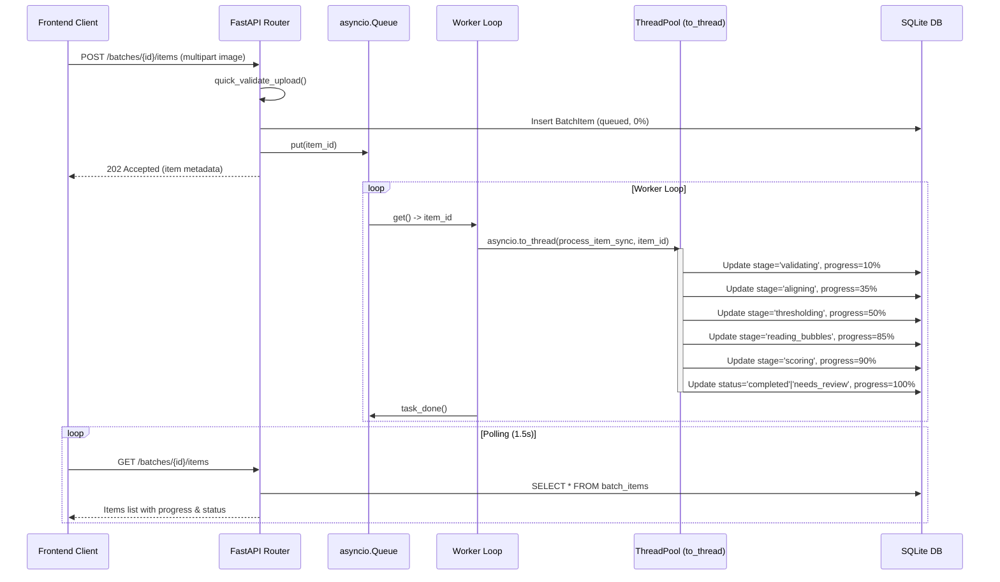
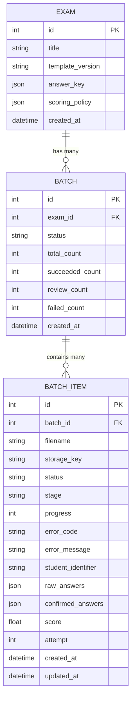

# Ambition Guru OMR - System Architecture & Technical Specification

This document provides an exhaustive, low-level technical architecture specification of the Ambition Guru Optical Mark Recognition (OMR) system. It details the algorithmic design, computer vision mathematics, concurrency model, data persistence, and security safeguards.

---

## 1. Architectural Philosophy & Design Goals

The OMR engine is architected around five primary engineering tenets:

1. **Non-Blocking Ingestion**: The HTTP API must never perform heavy image decoding or computer vision synchronously within request handlers. Uploads are acknowledged immediately with HTTP `202 Accepted`, delegating computation to a background worker.
2. **Empirical Measurement Over Coordinate Guessing**: Because physical printing and scanning introduce non-linear paper expansion and skew, sheet geometry is never hardcoded with hand-picked pixel coordinates. Geometry is derived through Hough circle detection and spatial clustering calibrated against real physical sheets.
3. **Double Verification Gates**: Every stage in the computer vision pipeline features self-verification (e.g., re-detecting markers on the warped image before bubble extraction) to detect transformation distortions immediately.
4. **Human-in-the-Loop Routing**: Erasing, light graphite strokes, double bubbling, and torn sheets must never produce silent false positives or negatives. Ambiguous items are automatically flagged with `needs_review` and surfaced to human reviewers.
5. **Stateful Crash Recovery**: In the event of a worker crash or server restart, any jobs stuck in `queued` or `processing` states are automatically recovered and requeued upon FastAPI application startup.

---

## 2. End-to-End System Dataflow

```
[Scanned Image (JPG/PNG)]
          │
          ▼
[FastAPI /batches/{id}/items] ──(quick_validate_upload)──> [Reject 400/413/415]
          │
          ├─► Upload raw bytes to MinIO (key: raw/{uuid4}.jpg)
          ├─► Insert BatchItem (status: 'queued', progress: 0)
          ├─► Increment Batch.total_count
          ├─► JOB_QUEUE.put(item_id)
          └─► Return HTTP 202 Accepted {id, status, ...}
                     │
                     ▼
             [asyncio.Queue]
                     │
                     ▼
           [worker_loop (asyncio)]
                     │
                     ▼
       [asyncio.to_thread(process_item_sync)]
                     │
      ┌──────────────┴──────────────┐
      │  Stage 1: validating (10%)  │ ──► Verify image dimensions (200px - 6000px)
      │  Stage 2: aligning (35%)    │ ──► Bullseye detection -> Warp (1700x2350) -> Verify (<=25px)
      │  Stage 3: thresholding (50%)│ ──► Grayscale convert & ROI masking
      │  Stage 4: reading (85%)     │ ──► Read 200 questions & 5-digit roll number
      │  Stage 5: scoring (90%)     │ ──► Score against AnswerKey & ScoringPolicy
      │  Stage 6: saving (95%)      │ ──► Update BatchItem and Batch counters
      └──────────────┬──────────────┘
                     │
         ┌───────────┴───────────┐
         ▼                       ▼
   [Needs Review]           [Completed]
   (needs_review=True)      (clean read)
         │                       │
         ▼                       │
   Proctor Review                │
 (/items/{id}/review)            │
         │                       │
         └───────────┬───────────┘
                     ▼
             [Results & Export]
           (/batches/{id}/results.csv)
```

---

## 3. Computer Vision & Mathematical Pipeline

### 3.1. Bullseye Registration Marker Detection

The sheet features 4 distinct bullseye registration marks positioned at the sheet corners. A bullseye consists of multiple alternating concentric black and white rings.

```
       Nested Rings:
        ┌─────────┐
        │  ●●●●●  │  Outer Ring (Radius ~40px)
        │ ● ┌─┐ ● │
        │ ● │●│ ● │  Inner Ring (Radius ~15px)
        │ ● └─┘ ● │
        │  ●●●●●  │  Center Circle (Radius ~5px)
        └─────────┘
```

#### Step 1: Inverted Binary Thresholding
```python
_, thresh = cv2.threshold(gray, 128, 255, cv2.THRESH_BINARY_INV)
contours, _ = cv2.findContours(thresh, cv2.RETR_TREE, cv2.CHAIN_APPROX_SIMPLE)
```
- Inverting the threshold maps dark ink to white ($255$) and white paper to black ($0$).
- `RETR_TREE` builds a full contour hierarchy, capturing nested rings inside outer rings.

#### Step 2: Circularity & Fill Ratio Filtering
For every extracted contour $C_i$:
1. Calculate area: $A_i = \text{contourArea}(C_i)$
2. Area constraint: $200 \le A_i \le 20,000$ pixels.
3. Compute minimum enclosing circle with center $(x_i, y_i)$ and radius $r_i$:
   $$A_{\text{circle}} = \pi \cdot r_i^2$$
4. Check circularity:
   $$\text{Circularity} = \frac{A_i}{A_{\text{circle}}} > 0.85$$

#### Step 3: Concentric Cluster Grouping
Because bullseyes have 3 to 4 nested rings, their centers $(x_i, y_i)$ are co-located:
- Two circular contours $i$ and $j$ belong to the same cluster if:
  $$\sqrt{(x_i - x_j)^2 + (y_i - y_j)^2} < 15\text{ pixels}$$
- Filter criterion: A cluster is accepted as a bullseye marker **if and only if** it contains **$\ge 3$ concentric rings**.
- Noise, alphanumeric characters, and filled answer bubbles have at most 1 ring and are filtered out.

#### Step 4: Corner Disambiguation
The 4 marker clusters are mapped to specific sheet corners using the image dimensions $W \times H$:
$$\text{Corner}(c_x, c_y) = \begin{cases}
\text{top\_left} & \text{if } c_y < H/2 \text{ and } c_x < W/2 \\
\text{top\_right} & \text{if } c_y < H/2 \text{ and } c_x \ge W/2 \\
\text{bottom\_left} & \text{if } c_y \ge H/2 \text{ and } c_x < W/2 \\
\text{bottom\_right} & \text{if } c_y \ge H/2 \text{ and } c_x \ge W/2
\end{cases}$$

If any corner is missing or ambiguous, an `AlignmentError("markers_not_found" | "markers_ambiguous")` is raised.

---

### 3.2. Perspective Transformation (Homography Warping)

To eliminate camera rotation, page skew, and perspective distortion, the image is mapped to a canonical coordinate space:
- **Canonical Width ($W_c$)**: $1700\text{ px}$
- **Canonical Height ($H_c$)**: $2350\text{ px}$
- **Margin ($M$)**: $60\text{ px}$

#### Coordinate Mapping
Source points $\mathbf{P}_{\text{src}} = [P_{\text{TL}}, P_{\text{TR}}, P_{\text{BR}}, P_{\text{BL}}]$ from detected clusters.  
Destination points $\mathbf{P}_{\text{dst}}$ from template:
$$\mathbf{P}_{\text{dst}} = \begin{bmatrix}
m_{\text{TL}, x} \cdot W_c & m_{\text{TL}, y} \cdot H_c \\
m_{\text{TR}, x} \cdot W_c & m_{\text{TR}, y} \cdot H_c \\
m_{\text{BR}, x} \cdot W_c & m_{\text{BR}, y} \cdot H_c \\
m_{\text{BL}, x} \cdot W_c & m_{\text{BL}, y} \cdot H_c
\end{bmatrix} = \begin{bmatrix}
60 & 60 \\
1640 & 60 \\
1640 & 2290 \\
60 & 2290
\end{bmatrix}$$

Using OpenCV's `getPerspectiveTransform`, a $3 \times 3$ transformation matrix $\mathbf{H}$ is derived:
$$\begin{bmatrix} x' \\ y' \\ 1 \end{bmatrix} \sim \mathbf{H} \begin{bmatrix} x \\ y \\ 1 \end{bmatrix}$$
The warped image is generated via:
```python
warped = cv2.warpPerspective(img, matrix, (canonical_w, canonical_h))
```

---

### 3.3. Post-Warp Verification Gate

A critical defense against flawed transformations is post-warp verification:
1. `find_registration_markers()` is re-executed on the warped image `warped_gray`.
2. The detected coordinates $(d_x, d_y)$ are compared against expected canonical coordinates $(e_x, e_y)$:
   $$\Delta x = |d_x - e_x|, \quad \Delta y = |d_y - e_y|$$
3. Verification criterion:
   $$\max(\Delta x, \Delta y) \le \text{tolerance\_px} \quad (25\text{ px})$$
4. If the check fails, `AlignmentError("alignment_failed")` aborts execution.

---

### 3.4. Bubble Reading & Thresholding

Every question bubble has relative center $(x_r, y_r)$ and relative radius $r_r$ in the template:
$$x_{\text{px}} = x_r \cdot W_c, \quad y_{\text{px}} = y_r \cdot H_c, \quad r_{\text{px}} = r_r \cdot W_c$$

#### Circular ROI Masking
For each bubble, a sub-image ROI is extracted around $(x_{\text{px}}, y_{\text{px}})$ with radius $r_{\text{px}}$:
```python
mask = np.zeros(roi.shape, dtype=np.uint8)
cv2.circle(mask, (x - x0, y - y0), r, 255, -1)
masked_pixels = roi[mask == 255]
```

#### Fill Ratio Calculation
A pixel is classified as "dark" if its grayscale intensity $I < 150$:
$$\text{Fill Ratio} (\mathcal{F}) = \frac{\sum_{p \in \text{ROI}} [I(p) < 150]}{N_{\text{ROI}}}$$

#### Classification Rules (`classify_question`)
Given fills for choices $\{A, B, C, D\}$, let the sorted values be $\mathcal{F}_{(1)} \ge \mathcal{F}_{(2)} \ge \mathcal{F}_{(3)} \ge \mathcal{F}_{(4)}$:

1. **Blank**:
   $$\mathcal{F}_{(1)} < 0.25 \implies \text{outcome} = \text{"blank"}, \quad \text{selected} = \text{""}$$
2. **Multiple Marks**:
   $$\text{Count}(\mathcal{F}_i \ge 0.40) \ge 2 \implies \text{outcome} = \text{"multiple"}, \quad \text{selected} = \text{"A,B"}$$
3. **Ambiguous**:
   $$(\mathcal{F}_{(1)} - \mathcal{F}_{(2)}) < 0.15 \implies \text{outcome} = \text{"ambiguous"}, \quad \text{selected} = \text{top1\_opt}$$
   *(Triggers `needs_review = True` on the sheet)*
4. **Single Clean Choice**:
   $$\text{Otherwise} \implies \text{outcome} = \text{"single"}, \quad \text{selected} = \text{top1\_opt}$$

---

### 3.5. Roll Number Grid Recognition

The sheet contains a 5-digit numeric matrix (columns $0$ to $4$, digits $0$ to $9$):
- Evaluated column-by-column where each column is treated as a 10-option question.
- If any digit column yields an outcome other than `"single"`, the digit is assigned `'?'` and `uncertain` is flagged as `True`.
- An uncertain roll number forces `result["needs_review"] = True`, preventing silent student misattribution.

---

## 4. Template Geometry & Calibration System

Template coordinates are maintained in `template_ambition_guru_v1.json` and generated by `app/templates/generate_template.py`:

```
                  Question Grid Layout (200 Questions)
      Col 1 (Q1-50)     Col 2 (Q51-100)    Col 3 (Q101-150)   Col 4 (Q151-200)
    A   B   C   D      A   B   C   D      A   B   C   D      A   B   C   D
    ○   ○   ○   ○      ○   ○   ○   ○      ○   ○   ○   ○      ○   ○   ○   ○
    ○   ○   ○   ○      ○   ○   ○   ○      ○   ○   ○   ○      ○   ○   ○   ○
    ... (50 rows)      ... (50 rows)      ... (50 rows)      ... (50 rows)
```

### Self-Consistency Check (`is_self_consistent`)
For a column of 10 digit bubbles detected by Hough circles:
1. Ensure count is exactly 10: $|Y| = 10$.
2. Calculate spacing gaps: $G_i = y_{i+1} - y_i$.
3. Check maximum gap variation against minimum gap:
   $$\max(G) \le \min(G) \times 1.4$$
This eliminates false detections caused by noise or smudges coincidentally matching count.

---

## 5. Concurrency Model & Worker Architecture



### Crash Recovery on Startup
The application lifespan manager initializes the queue and heals stale records:
```python
@asynccontextmanager
async def lifespan(app: FastAPI):
    ensure_bucket_exists()
    worker_task = asyncio.create_task(worker_loop())
    await requeue_stale_items()
    yield
    worker_task.cancel()
```
`requeue_stale_items()` queries all `BatchItem` rows where `status IN ('queued', 'processing')`, resets their status to `'queued'`, and re-enqueues their IDs into `JOB_QUEUE`.

---

## 6. Database Schema & Data Models



---

## 7. Security & Input Sanitization

### 7.1. Storage Key Randomization
Untrusted filenames from client file uploads are completely discarded:
```python
def _generate_key(prefix: str, extension: str) -> str:
    return f"{prefix}/{uuid.uuid4().hex}.{extension}"
```
Raw images are saved to MinIO as `raw/<hex-uuid>.jpg`. This completely neutralizes directory traversal (`../../etc/passwd`) and null byte attacks.

### 7.2. Upload Dimension & Size Constraints
- Maximum file size: $10\text{ MB}$ (`10 * 1024 * 1024` bytes)
- Minimum image dimension: $200 \times 200\text{ px}$
- Maximum image dimension: $6000 \times 6000\text{ px}$
- Content-type validation: strictly `image/jpeg` or `image/png`.

### 7.3. CSV Formula Injection Defense
When exporting batch results to CSV, malicious student identifiers or answers starting with formula prefixes could trigger Remote Code Execution (RCE) or data exfiltration in Microsoft Excel or Google Sheets. The export engine neutralizes prefixes:
```python
DANGEROUS_PREFIXES = ("=", "+", "-", "@")

def _sanitize_cell(value) -> str:
    text = "" if value is None else str(value)
    if text.startswith(DANGEROUS_PREFIXES):
        return "'" + text  # prepend single quote to force plain text rendering
    return text
```

---

## 8. Frontend Architecture & Reactivity

### 8.1. Bounded Concurrency Uploads
The Pinia store (`src/stores/omr.ts`) processes files through a client-side queue limited to 3 concurrent workers. This prevents network congestion and connection timeouts when dropping 50+ images at once:
```typescript
const queue = [...reactiveRows]
async function worker() {
  while (queue.length > 0) {
    const row = queue.shift()
    if (!row) continue
    await uploadRow(row)
  }
}
const workers = Array.from({ length: 3 }, () => worker())
await Promise.all(workers)
```

### 8.2. XMLHttpRequest Upload Progress
Modern `fetch()` does not expose native upload stream progress events across browsers. The application uses `XMLHttpRequest` with `xhr.upload.onprogress` to drive the transfer progress bar (0% to 100%), seamlessly switching to server-side processing progress once the upload completes.

### 8.3. Human Review Modal (`SheetReview.vue`)
- Automatically flags questions that were left blank or had multiple marks detected.
- Renders an interactive 10-column layout of the 200 questions.
- Enforces strict 5-digit validation on student roll numbers before submitting to `/review`.
